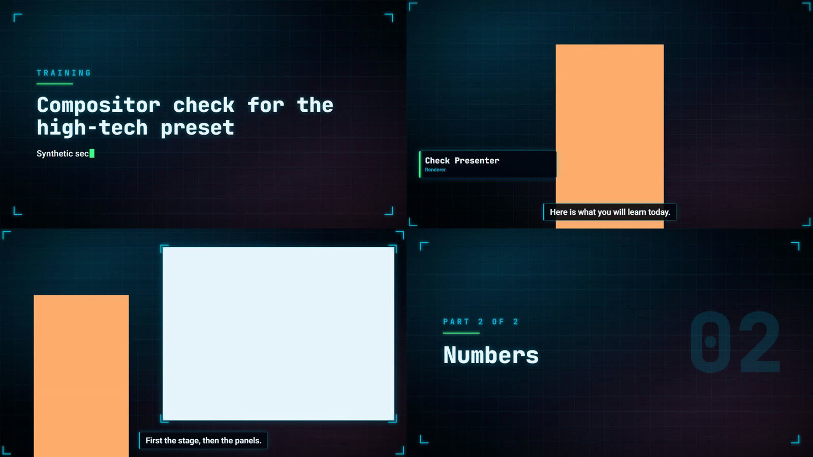
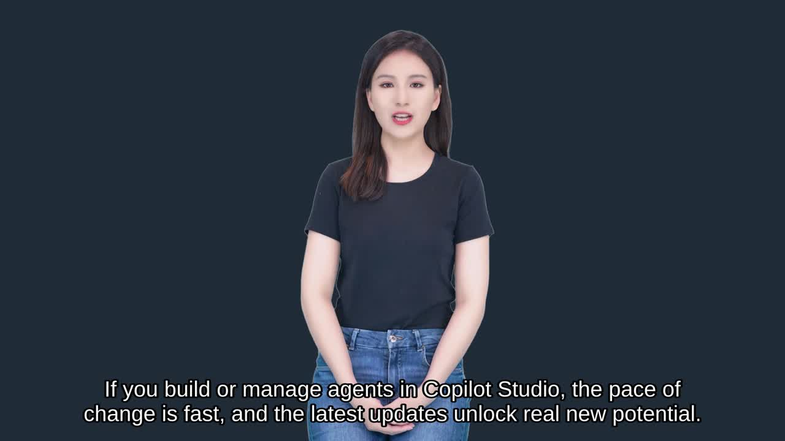
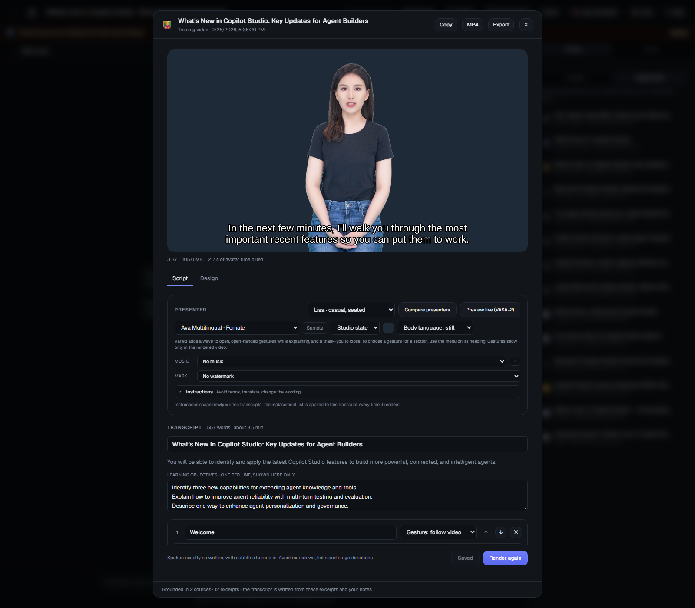
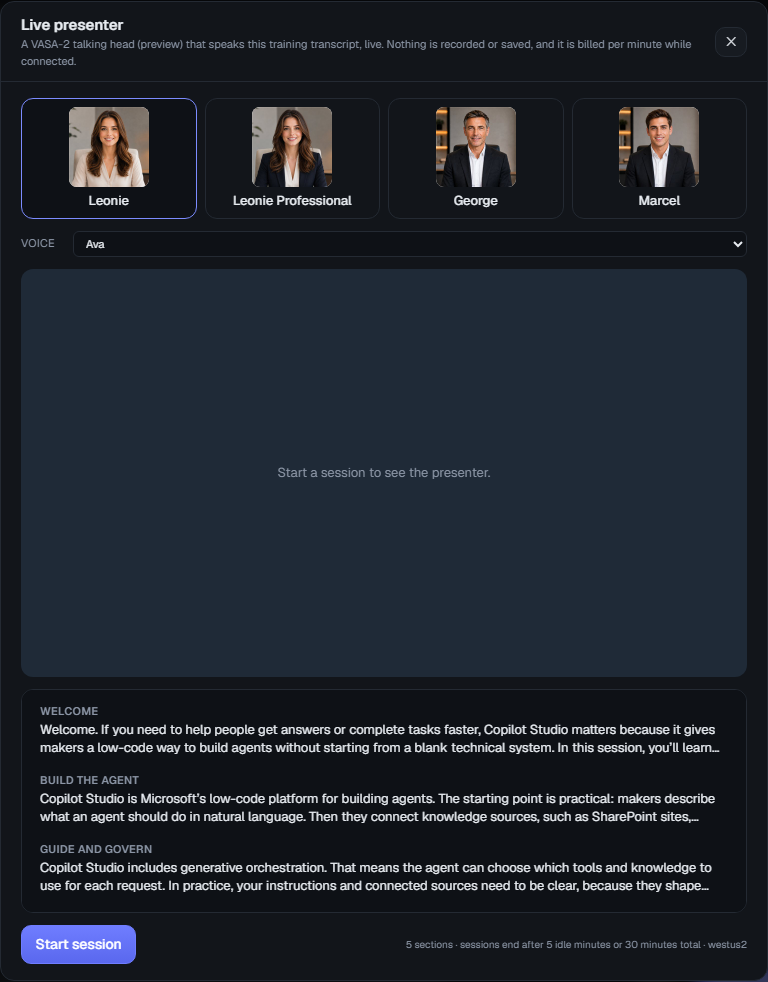

# Training videos

The 🧑‍🏫 **Training video** card turns a notebook's research into a short
training session delivered by a realistic, lip-synced presenter. It works in
two steps, so nothing is billed for video until you are happy with the script.

1. **Write transcript.** Only checked sources supply the evidence; the focus
   box guides the topic. Notebook notes, including saved chat answers, are not
   included unless you add their content as sources and check them. The model
   writes a welcome and learning objectives, a handful of
   teaching sections, a recap, and a spoken knowledge check. The script is saved
   as a `training` artifact and opens in an editor.
2. **Render video.** Edit the title, sections and presenter, then press
   **Render video**. The script is sent to Azure's text-to-speech avatar batch
   service. The finished file is saved locally and plays in the artifact;
   **MP4** in the header downloads it.

The card's **Style** (under **Options ▸**) picks one of two kinds of video:

- **Presenter with slides and visuals** (the default). Title cards, bullet
  points, key numbers, quotes, knowledge checks, AI pictures, screenshots and
  source-compatible notebook infographics slide in beside or behind the presenter, each at
  the moment the presenter says the words it illustrates. See
  [Presenter with visuals](#presenter-with-visuals).
- **Presenter only.** The presenter speaking on a solid brand background, with
  subtitles burned in. This is what every training video made before visuals
  existed renders as.

Editing is locked while a render runs. If you change the script afterwards, the
editor says the video is out of date and offers **Render again**.

The card and the editor also have a **Music** picker and an **Instructions**
panel. Music is mixed into the MP4 after the video is finished, lowered whenever
the presenter speaks. The replacement list is applied to the transcript each
time it is sent for rendering. See
[Spoken formats](studio.md#spoken-formats-script-review-instructions-and-music).
The **Mark** picker stamps an optional text or image watermark in one of nine
positions after the music is mixed; see [Watermark](studio.md#watermark).

### Troubleshooting render preparation

**Render video** saves edits, finds missing pictures, draws and uploads visuals,
then submits the render. A failure identifies the step; request failures include
the HTTP method, endpoint and status, or **no HTTP response** when the browser
could not obtain one. The browser **Console** contains the original error and
request context. Drawing failures identify the visual and section instead:
image or font loading during browser capture can fail before any render request
is sent, so there may be no render response in the Network panel.

Slow picture lookup and render submission keep the connection active while
waiting for the server.
If the connection drops during submission, check the video's progress before
clicking **Render video** again: Azure may already have accepted the job.
Completed visual uploads are cached and reused on the next attempt.

#### "Could not reach Azure OpenAI" versus "the connection was closed or timed out"

These are different problems and the message says which one it is.

- **Could not reach Azure OpenAI at …** means the endpoint could not be
  resolved or connected to: DNS, a refused connection, no route, or a
  certificate or proxy problem. Check `AZURE_OPENAI_ENDPOINT`, the network, VPN
  and firewall, and restart the server after changing `.env.local`. The
  placeholder endpoint from `.env.example` gets its own message.
- **The connection to Azure OpenAI … was closed or timed out before a reply
  arrived** means the endpoint is fine but one request lost its connection
  (`ECONNRESET`, `UND_ERR_SOCKET`, a header or body timeout). It is usually a
  passing network problem, or a slow image generation that a VPN, proxy or
  firewall cut off. It is safe to retry, and if the request never completed
  nothing was billed. The response code is `503` with `"code":
  "connection_dropped"`.

Picture and chat calls to the model already retry on their own: a dropped
connection up to twice (1 and 2 seconds apart), an unreachable host once, and a
429, 408 or 5xx up to four times, honoring `Retry-After`, within three minutes in
total. A call whose reply had already started arriving is never repeated, so a
picture is not billed twice. The SDK's own retries are switched off for these
calls so the two layers do not multiply.

When **Render video** or **Add pictures** still cannot create some pictures
after those retries, the pictures that worked are saved and the rest are
reported: "1 of 12 pictures could not be created, so the video has not been
rendered yet. The 11 that worked were kept." **Retry missing pictures** asks for
only the missing ones and carries on to the render; **Render without them**
renders those visuals with words only. A problem that would repeat for every
picture, such as a rejected credential, a missing configuration or the daily
budget, stops the run at once instead.

## Presenter with visuals

A composed training video starts with the avatar and lays visuals over and
around it on one timeline:

- **Visuals tied to words, not times.** Each visual is pinned to a phrase of
  its section's script, such as "it uses about 40 percent less water". It
  appears as the presenter starts saying that phrase. Bullet points are revealed
  one by one as each is spoken, and a knowledge check reveals its answer when
  the presenter starts giving it. Because visuals follow words, editing the rest
  of the script never knocks them out of sync. A visual whose words no longer
  appear is flagged, and is placed by its order until you fix it.
- **Planned with the transcript.** The studio model plans the visuals right after
  writing the transcript. It copies its anchors word for word from the script,
  and anything whose words are not in the script is dropped. **Plan all visuals
  again** and **Plan this section** on the **Visuals** tab plan them again
  after you edit the script.
- **Layouts.** Each visual chooses where the presenter stands: presenter left
  with the visual right, presenter right with the visual left, the visual full
  frame with the presenter in a corner, or the visual alone while the voice
  continues. The presenter glides between layouts. A **Back to presenter** cue
  returns to the presenter alone.
- **Kinds of visual.** Title card, learning objectives, bullet points, key
  number, quote, knowledge check, AI image (drawn on demand by the image model),
  video clip (a short generated clip, see [below](#video-clips-as-visuals)),
  screenshot or picture (upload, paste or capture a screen), and notebook
  infographics grounded entirely in the video's selected sources.
- **A picture on every slide.** Title cards, objectives, bullet points, key
  numbers, quotes and knowledge checks show a picture of the idea beside their
  words: above them on the side panel, beside them on a wide one. When the idea
  concerns a Microsoft product, the planner writes a Microsoft Learn search and
  a real screenshot is taken only from a selected Learn source page, credited
  "Microsoft Learn" on the slide. No outside articles are searched.
  Otherwise, or when selected Learn pages have nothing
  suitable, the image model draws an illustration from the planner's
  description. Pictures are found while the visuals are planned, as time
  allows; **Add pictures to N visuals** on the **Visuals** and **Preview** tabs
  fills the rest, and rendering does too. Each visual's editor can search the
  same selected Learn pages again (**Find another**), draw, upload or remove its picture. A slide whose
  search and drawing both fail shows its words alone.

Visual replanning uses the original selected-source excerpts as evidence, not
just the edited transcript. Unverified or unrelated infographics are excluded
and direct API references are rejected. Generated illustrations are decorative;
manual text and picture edits are not automatically fact-checked. Existing
scripts and videos remain snapshots and are not automatically regenerated when
source content changes. See [Grounding boundaries](grounding.md#studio-and-library-boundaries).

- **Capitalization.** On-screen text is shown as an edited slide would be:
  sentence case, with product names and acronyms written the way the script
  writes them ("Copilot Studio", "AI"), even when the planner copied the words
  in lowercase from mid-sentence. Text is only ever capitalized, never lowered.
- **Transitions.** Cut, fade, slide in, wipe or zoom, plus a slow push-in on
  pictures.
- **Animation controls.** In **Design > Animation**, choose **None**,
  **Light (transitions only)**, or **Full**, then customize the toggles for
  visual transitions and fades, picture push-ins, progressive bullet reveals,
  and presenter gliding between layouts. These settings apply to existing and
  new visuals in both the preview and exported MP4. **Full** preserves the
  original behavior. **None** uses instant cuts, keeps pictures still, shows
  all bullets together, and switches presenter layouts without gliding.
  Knowledge-check answers still appear when spoken, and the presenter's own
  gestures and speech are unchanged. Individual visuals' transition and
  picture-motion choices are preserved and take effect again when their
  animation toggle is enabled. Changing only animation requires recomposition,
  not new avatar clips.
- **Design.** The **Design** tab sets the look (Standard or High-tech HUD), the
  theme colors, the default layout and
  transition, the corner for the small presenter, opening and closing cards, a
  title card between sections, an on-screen name for the presenter, a logo, the
  resolution (720p or 1080p) and captions: burned in, a separate WebVTT file,
  or none.
- **High-tech look.** Choose **High-tech HUD** under **Look** (in the Studio
  card's style row or **Design**) for a futuristic style. It also selects the
  **High-tech** theme colors, which you can change afterward. The default,
  **Standard**, is unchanged. See [The high-tech look](#the-high-tech-look).

### Editing and previewing

The editor of a composed video has four tabs. A presenter-only video, one made
without a composition, shows just **Script** and **Design**.

| Tab | What it does |
|---|---|
| **Script** | The transcript, presenter, voice, background, music and instructions |
| **Visuals** | Each section's script, with visual anchors highlighted. Select words, then **Add visual at selected words** to place a new one there. Expand a visual to change its kind, layout, transition, words, timing nudge and content |
| **Design** | The video-level look described above |
| **Preview** | Plays the composed video in the browser from the same timeline the renderer uses. Markers on the strip below the player show every visual; clicking one opens it for editing |

The browser preview has no avatar-rendering charge. It times the speech by synthesizing each sentence
with the presenter's own standard neural voice through the ordinary speech
endpoint, which costs a fraction of a cent per video and is cached. It plays
that voice under the visuals. Until the presenter has been rendered, the spot
where they will stand shows one of the section's pictures, labeled "Presenter
appears here once rendered". Once the presenter has been rendered, the preview
plays the real transparent presenter clips instead. Without Azure Speech
configured, timing is estimated from the word count and the preview is silent.

### Video clips as visuals

When a [video model is configured](video-clips.md#providers), a visual can be a
short **Video clip** of generated B-roll that plays muted in the visual's panel
while the presenter's voice continues. Clips cost money per second, so they are
always opt-in:

- **Planning proposes none by default.** Tick **Propose video clips** beside
  **Plan all visuals again** (it appears only when a video model is configured)
  and the planner may add a few, each with a prompt describing one continuous
  shot. Proposing costs nothing. Planning again replaces every visual,
  including clips you already made.
- **A clip is made only when you press Generate** in the visual's editor, after
  editing its prompt. The editor shows the shape, length and quality choices the
  model supports, an **estimated cost** (also checked against `DAILY_BUDGET_USD`),
  a status line, **Cancel**, a player for the result, **Generate another** and
  **Remove clip**. You can add one by hand by choosing **Video clip** as a
  visual's kind. With no video model configured the editor says so and links to
  the setup guide.
- **A visual without a clip is left out of the render**, with a warning in the
  preview. Rendering never makes a clip and never bills for one.
- **Preview.** The browser preview plays the clip in its panel, muted, at the
  right moment, and scrubbing shows the right frame.
- **Fitting.** The clip plays from the moment its visual appears, in the panel
  at its own aspect ratio (a portrait clip is pillarboxed, never stretched),
  under the visual's caption and with the rounded panel corners. A clip longer
  than its visual is cut where the visual ends; a shorter one **holds its last
  frame**, or **loops** if you choose that. The presenter's voice stays the only
  audio: the clip's own sound is never used. Watermarks, captions and the
  logo are drawn over it as for any visual.
- **Both renderers.** The standard Python compositor and HyperFrames play clips
  the same way (`npm run check:training` and `npm run check:training -- --hyperframes`
  compose a synthetic clip and check that it is not stretched and holds).
  HyperFrames first cuts, holds or loops each clip to its visual's length
  without sound, using the same ffmpeg the compositor uses.
- **Storage.** Clips live under the training video and are deleted with it;
  clips no visual uses any more are removed at the next render.

### Intro and outro clips

**Design → Intro and outro** adds an optional clip before the first section and
after the last. Each is **off by default**, so nothing is billed unless you ask,
and a video without them renders exactly as before. Pick a source per clip:

- **Generate with AI.** *Draft a prompt from the video* asks the chat model for
  an opening (intro) or closing, thank-you (outro) shot from the title and
  script, with no on-screen text. Edit it, choose a length (default about 5
  seconds, the nearest the model offers) and quality, and press **Generate**.
  The button and the **Estimated cost** line show the price first, and the daily
  budget applies. **Cancel**, retries and moderation messages work as in
  [Video clips](video-clips.md).
- **Use a clip from this notebook.** Any finished clip from the Studio
  **Video clip** generator. It is copied, so deleting the original later does
  not break this video.
- **Upload a video.** An MP4 up to 100 MB.

The **Final order** strip shows the intro, the video and the outro with their
lengths and the total. **Join** chooses a short cross-fade (the default), a
long one or a plain cut; a fade is never more than half the shortest piece.

How it renders. The video is rendered first, by either renderer (Python or
HyperFrames, including the high-tech look), and the clips are then joined
around it, so every renderer behaves the same:

- Total length is the pieces added up, less one fade per join. Burned captions,
  speech, visuals and music are inside the video and stay in step; the **WebVTT
  captions file** is shifted by the intro. Intro and outro have no spoken text,
  so the transcript and captions never include them.
- Every piece is scaled to the video's size and frame rate, never stretched: a
  clip of another shape is fitted and padded with black.
- A clip's own sound is used if it has any (matched in loudness, 48 kHz stereo),
  otherwise it is silent; tick **Play without its own sound** to silence it.
  The background music and the presenter play only under the video itself, so
  the music does not run over the intro or outro.
- The **watermark** covers the intro and outro as well, because it is stamped on
  the finished file.
- The MP4 download includes them. The live VASA preview is unaffected.

Generated clips are kept and reused: re-rendering never regenerates or re-bills
them, and only **Regenerate** makes a new one. A render is refused (with the
reason, and nothing lost) while a requested intro or outro has no clip, so one
is never silently dropped; use **Try again**, **Render without it** (turns the
slot off) or choose another source. If joining fails after a successful render,
the video is kept without them and the render note says so.

### How it renders

1. **Visuals are drawn in the browser.** Visuals still without their picture
   get one first: a Microsoft Learn screenshot, or a generated illustration.
   Then every visual, and every build step of
   bullets and knowledge checks, is drawn as a PNG at its exact size by the same
   components the preview shows, and uploaded. Only visuals that changed since
   the last render are drawn again.
2. **The presenter is rendered per section.** Each section is a separate Azure
   avatar job, rendered as a transparent WebM (VP9 with alpha) without
   subtitles. Up to `AZURE_AVATAR_CONCURRENCY` jobs run at once. Clips are
   cached by presenter, voice and words, so a section whose words did not change
   is never rendered or billed again. Changing only visuals, design or music
   shows **Recompose video**, which costs no avatar time.
3. **Timing.** Each section starts when its clip starts, and the measured
   sentence timings are scaled to the clip's real length. Anchors land within a
   few tenths of a second of the spoken words.
4. **Compositing.** `scripts/training/render.py` decodes the clips with their
   alpha channel and composes them over the visuals, with transitions, cards,
   captions and the logo. It mixes the clips' audio, normalizes loudness to
   −16 LUFS, then mixes in any music. A title card between sections hides the
   cut between clips. If a clip ever arrives without transparency, its flat
   background is keyed out.

Compositing takes roughly a minute of computer time per minute of 720p video,
and longer at 1080p. While it runs, the card shows a bar and percentage of the
video drawn so far; the renderer reports it every couple of seconds of video.
It needs Python with `numpy`, `Pillow` and
`imageio-ffmpeg`, the same as whiteboard and motion videos. Run
`npm run check:training` to compose a short synthetic video and confirm the
setup works. It needs no Azure or model access.
Use `npm run check:training -- --no-animation` to check the animation-free
rendering path.

Presenter clips keep their own shape. Full-body avatars arrive as 16:9 frames
that fill the presenter's box, while the talking-head (photo) avatars are
512 × 512 squares, which are fitted inside the box at their natural aspect
ratio: the face is never stretched, and a head sits at about 40% of the frame's
height beside a visual (full height only when the presenter is alone). Videos
composed before this fix show a stretched head and need to be recomposed
(**Recompose video** reuses the rendered clips, so it costs no avatar time).
`npm run check:training -- --head` (add `--hyperframes` for the other
renderer) composes square talking-head clips and fails if the presenter's face
in the result is not round.

### The HyperFrames compositor

Set `TRAINING_RENDERER=hyperframes` to compose with
[HyperFrames](https://github.com/heygen-com/hyperframes) instead of
`render.py`. The timeline is the same, so the preview, the captions file and the
timing do not change. Only step 4 differs:
`src/lib/traininghyperframes.ts` turns the timeline into one HTML composition
(the stage, each visual's drawings, the presenter's clips inside a wrapper that
glides between poses, cards, lower third, captions and logo, all animated with
GSAP), and `src/lib/hyperframes.ts` renders it in headless Chrome at 30 fps.
`scripts/training/hf_assist.py` then normalizes the loudness to −16 LUFS, so the
music mix and watermark steps work as before. Captions are real text, so they
render sharper than the compositor's.

It needs, besides Python: Node (the app's own), `ffmpeg` on `PATH`, Chrome (which
HyperFrames downloads on first use) and network access for `npx` to fetch the
pinned HyperFrames release the first time. Set `HYPERFRAMES_BIN` to use an
installed `hyperframes` instead. Each worker is a Chrome process, so
`HYPERFRAMES_WORKERS` limits how many run at once. The Docker image does not include
these; the app falls back to the Python compositor, and the video's note says
so, whenever HyperFrames cannot render, or when a presenter clip arrived
without transparency (only `render.py` keys out a flat background).

Run `npm run check:training -- --hyperframes` to compose the synthetic video
this way. The bundled `scripts/hyperframes/gsap.min.js` is GSAP, used under its
[standard license](https://gsap.com/standard-license/).

### The high-tech look



*Frames from a short sample rendered with HyperFrames. The pictures and
presenter are placeholders.*

Set **Look** to **High-tech HUD** (`composition.look: "hightech"`) to draw the
video in a futuristic HUD style. The timeline, slides, presenter clips, captions
file and audio are the same; the frame around them changes:

- A dark stage with a drifting grid, glow, scanlines and a vignette, and corner
  brackets that draw in and pulse.
- Every visual sits in a neon frame with corner brackets and a scan line that
  sweeps down it, and arrives with a glitch burst (jitter and a red/cyan
  channel split) instead of the usual slide, zoom or wipe. Cuts stay cuts.
- Title, section and closing cards are live text: a spread-out eyebrow that
  closes up, a title that reveals letter by letter through random symbols, a
  neon rule, a typewriter line with a cursor, and a large section number.
- The lower third decodes the presenter's name and types their role.
- Captions get a neon-edged dark panel.

Text stays legible on any theme: panels are always dark glass and type is
always near-white; the theme only supplies the neon accents. The style uses only
system fonts (Consolas, DejaVu Sans Mono, Segoe UI) and CSS, so a render needs
no network beyond `npx`. Randomness comes from a PRNG seeded by the text, so
the same video always renders the same frames.

The animation setting still applies: with **None**, the style is drawn but
nothing moves. Frames and slides already drawn in the browser are not
restyled, so the **High-tech** theme (dark navy with cyan, green and magenta)
is what makes them match.

**Renderer.** The high-tech look needs HyperFrames, so it is used
automatically whenever `npx` (or `HYPERFRAMES_BIN`) can start, without setting
`TRAINING_RENDERER`. Setting `TRAINING_RENDERER=python` turns that off. If
HyperFrames is not available or its render fails, the video is made with the
Python compositor in the standard style, and the video's note says the
high-tech effects were skipped. The in-browser preview shows the standard
style either way, with no added animation.

## Sample

[](https://github.com/user-attachments/assets/7651fdca-42dd-45e4-8e56-f56f07c3b6d9)

*Click the image to play the 3:37 sample, shown here at 720p.* It was generated from a notebook of
two public "What's new in Copilot Studio" pages, using the Short length and Lisa
(casual) with the Ava voice.



## Measured

The sample above is a real run:

| Step | Result |
|---|---|
| Write transcript | 32 s with `gpt-5-mini`, 5 sections, 557 words |
| Render | about 4.5 minutes from submission to a saved MP4 |
| Output | 3:37 at 1920x1080, H.264, 217 s of avatar time billed |

Videos are requested at 2 Mbps, about 15 MB per minute. That is ample for a
presenter on a flat background.

## Why the text-to-speech avatar, not a generative video model

Foundry offers a lip-synced presenter through the Azure Speech avatar service.
Generative video models (see [Video clips](video-clips.md); Sora 2, which this
page used to compare against, was retired in 2026) are a different tool:

| | Generative video model | Text-to-speech avatar (Azure Speech) |
|---|---|---|
| Clip length | A few seconds to about 15 per generation | Up to 20 minutes per job |
| Same presenter throughout | No: each clip is a new person | Yes |
| Lip-sync to a script | No | Yes, driven by the neural voice |
| Approximate price | About $0.07 to $0.10 per second | Roughly $0.50–$2 per minute |

A training video is minutes of one person talking, so it needs a stable,
lip-synced presenter for its whole length: that is the avatar. A generative
video model is the better creative tool for a few seconds of B-roll, which is
why a visual can now be a [short generated clip](#video-clips-as-visuals) that
plays beside or instead of the presenter while the presenter's voice continues.

## Setup

Training videos reuse the Azure Speech configuration from
[Audio overviews](audio-overviews.md). Additionally:

- The Speech (or AI Services) resource must be in an **avatar region**:
  East US 2, West US 2, South Central US, West Europe, North Europe,
  Sweden Central or Southeast Asia.
- Your identity needs **Cognitive Services Speech User** on that resource. It
  includes the `BatchAvatar/*` data actions. Subscription *Owner* or
  *Contributor* does not grant them, so an Owner still gets a 403.

  ```bash
  az role assignment create --assignee <your-object-id> \
    --role "Cognitive Services Speech User" --scope <AZURE_SPEECH_RESOURCE_ID>
  ```

- Entra auth calls the resource's custom-domain endpoint,
  `https://<account>.cognitiveservices.azure.com`, derived from
  `AZURE_SPEECH_RESOURCE_ID`. Set `AZURE_SPEECH_ENDPOINT` if yours differs.
  With `AZURE_SPEECH_KEY` the regional endpoint is used instead.

Optional settings:

| Variable | Effect |
|---|---|
| `AZURE_AVATAR_BACKGROUND_URL` | A public image shown behind the presenter instead of the chosen color (presenter-only videos) |
| `AZURE_AVATAR_PRICE_PER_MINUTE` | Shows an estimated cost in the editor before rendering |
| `AZURE_AVATAR_CONCURRENCY` | Section clips of a composed video rendered at once (default 2, at most 8) |
| `TRAINING_IMAGES` | Set to `off` to stop the visual planner proposing AI images and drawing illustrations for slides. Screenshots can still be found within selected Microsoft Learn source pages |

## Presenters and voices

Every standard full-body avatar Microsoft lists is offered: Lisa, Lori, Meg, Harry
and Max in all their styles, plus Rowan, Celine, Nia and Malik. Each has a default
neural voice. The voice picker lists the en-US voices from the Speech `voices/list`
API (cached for 24 hours; a built-in list is used if the service is unreachable),
including HD and preview MAI voices. Voices with speaking styles offer a style
menu, and a Sample button plays a short clip of the chosen voice and style. Styles
that measurably do nothing are hidden. The 30 VASA-1 talking-head (photo) avatars
are offered too. Four newer VASA-2 avatars (Leonie, Leonie Professional, George
and Marcel) are defined but hidden and blocked, because Microsoft's docs say batch
synthesis does not support `vasa-2` yet; add `"vasa-2"` to `BATCH_PHOTO_MODELS`
in `src/lib/avatars.ts` once it does. Jeff is left out because Microsoft
retires him in December 2026.

### Live VASA-2 presenter

The four VASA-2 avatars can be used today through the training video editor:
open a generated training video and choose **Script > Preview live (VASA-2)**.
It streams the avatar in your browser over WebRTC with the Speech SDK (real-time
synthesis, which supports `vasa-2`), so it does not use batch synthesis. Pick a
presenter and voice, press **Start session**, then **Play transcript** (or **Play
from here** on any section). The presenter speaks the transcript the app wrote,
including your edits, so nothing needs typing.



- Live only: nothing is recorded, saved or added to a training video, and the
  background cannot be transparent.
- The server hands the browser a short-lived Speech token and a relay server
  (`/api/live-presenter`). The server exchanges its own credential (the key, or
  its Entra token) for that short-lived Speech token and returns only the
  exchanged token, so keys and Entra tokens never reach the page. With Entra, set
  `AZURE_SPEECH_RESOURCE_ID` (or `AZURE_SPEECH_ENDPOINT`) so the server can reach
  the resource's endpoint.
- `AZURE_SPEECH_REGION` must be West US 2, Central India, Southeast Asia or
  Sweden Central, the only regions Microsoft lists for `vasa-2` (preview). The
  panel says so when it is not.
- Your network must allow WebRTC to `relay.communication.microsoft.com` (UDP 3478,
  TCP 443). Sessions end after 5 idle minutes or 30 minutes in total. Each session
  start counts about 25 cents against the daily budget.

## Limits and behavior

- **Length.** Short, medium and long target about 3, 6 and 10 minutes. The
  service accepts up to 20 minutes, and the editor blocks rendering when the
  word count would exceed that.
- **Rendering time.** Azure renders in the cloud. The measured sample took
  about 1.25 minutes of wall-clock time per minute of video. Progress is
  stored on the artifact, so you can close it and carry on, and watching
  resumes after a server restart.
- **Rate limit.** On the S0 tier the service accepts about two new render jobs
  a minute, and answers anything faster with a 429 and a "retry after N
  seconds" message. See [Rate limits](#rate-limits) for how renders cope.
- **Rendering time for composed videos.** Transparent VP9 clips render more
  slowly in Azure than the H.264 presenter-only video, and compositing adds
  local time on top.
- **Cleanup.** Once a video or clip is downloaded, its Azure job is deleted.
  Deleting the artifact or its notebook deletes the local files too: the MP4,
  the cached presenter clips, the drawn visuals, captions and its pictures.
  After each composed render, clips and drawings the script no longer uses are
  removed.
- **Billing.** The finished artifact records the avatar seconds Azure billed.

## Rate limits

Azure limits how fast a Speech resource may create avatar jobs. On the S0 tier
the "Create avatar batch synthesis" call is refused with a 429 ("have exceeded
call rate limit … Please retry after 7 seconds") when jobs are started too
quickly, which a composed video, with one job per section, can do.

- **Retries.** A create, status or delete call that gets a 429, 408, 500, 502,
  503 or 504, or loses its connection, waits and tries again. It waits for the
  `Retry-After` header (seconds or a date), or the "retry after N seconds" in
  Azure's message, plus up to a second of jitter. Without either it backs off
  2, 4, 8 … seconds, up to 30, with jitter. Calls fail at once on 400, 401, 403
  and 404, whose messages are unchanged.
- **Budget.** A call makes at most `AZURE_SPEECH_MAX_RETRIES` retries (default
  6) and waits at most `AZURE_SPEECH_RETRY_BUDGET_SECONDS` in total (default
  180). A `Retry-After` longer than what is left of the budget ends the call
  straight away rather than sleeping uselessly. Status checks use a smaller
  budget, since the poller asks again anyway.
- **No double billing.** Each create is a PUT to a job id the app chose, so a
  retry after a lost reply finds the job already exists (409) and adopts it
  instead of starting a second one.
- **Spacing.** New jobs start at least `AZURE_AVATAR_SUBMIT_SPACING_MS` apart
  (default 2000; the first goes at once, so a single render is not slowed). A
  429 pushes every later create and status check back by the wait it asked for,
  and polling slows down the same way. At most `AZURE_AVATAR_CONCURRENCY`
  section jobs run at once.
- **Progress.** While a call waits, the progress card says so: "Azure Speech is
  rate limiting requests; retrying in 7 s (attempt 2 of 7)." If only a new
  section is refused, the sections already rendering carry on, and the render
  fails only when nothing is left running.
- **When the budget runs out,** the render stops with a message saying Azure
  kept refusing, that nothing was billed for the refused request, and what to
  do: wait a minute and press **Render** again, ask Azure support to raise the
  Batch Avatar call rate limit for the Speech resource (or use a higher tier),
  or shorten the video to fewer sections.
- **Nothing finished is lost.** Presenter clips are cached by presenter, voice
  and words, so sections that already finished are reused and are not billed
  again when you render again.
- **Cancelling.** Deleting the video stops its waiting within a few seconds.
